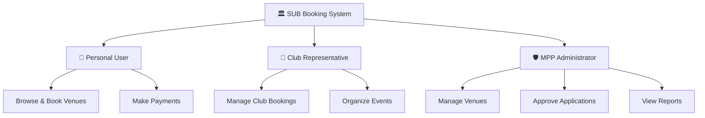
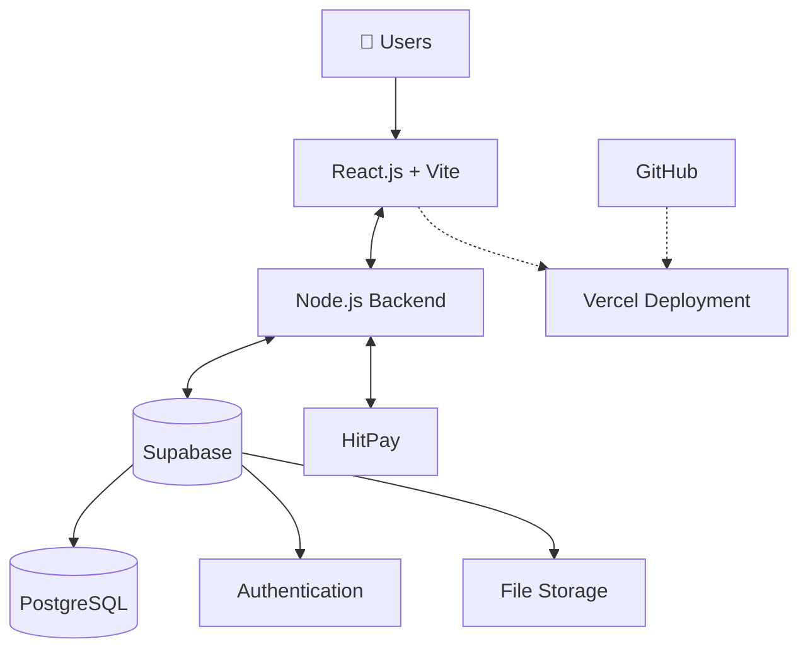

# 🏛️ SUBook - Event and Venue Booking System

  A centralized platform for university venue booking and campus event management.

## 1. 📌 Project Overview

A web-based platform that simplifies university facility booking and event management by connecting students, club representatives, and MPP administrators.

**Objectives:**
- Simplify venue booking procedures.
- Centralize booking and event management.
- Improve administrative efficiency.
- Enhance user experience.

## 2. 👥 User Roles

## 3. 🚀 Main Features

| Module | Key Features |
|---|---|
| 🔐 Authentication | Google SSO, role-based access |
| 🏟️ Venue Management | Venue listing and availability |
| 📅 Booking Management | Applications, calendar, approvals |
| 💳 Payment Management | HitPay, transactions, refunds |
| 🎉 Event Management | Club event creation and scheduling |
| 🤖 AI Features | OCR scanning, recommendation chatbot |
| 📊 Admin Dashboard | Analytics and report generation |

## 4. 🛠️ Technology Stack

  

| Technology | Purpose |
|---|---|
| React.js + Vite | Frontend development |
| Node.js | Backend development |
| Supabase | Database, authentication, storage |
| Vercel | Application deployment |
| GitHub | Version control and collaboration |
| HitPay | Online payment processing |

## 5. 🏗️ System Architecture

## 👨‍💻 Project Team

| Member | Role | Main Responsibility |
|---|---|---|
| Chia Thung Thung | Frontend Developer & UI/UX Designer | UI design, responsive pages, dashboards |
| Ung Yii Jia | Project Manager | Agile management, documentation, AI modules |
| Wong Ya Jing | Backend Developer | Backend, Supabase, HitPay integration |
| Yeoh Huey Ting | System Analyst, QA & MPP Admin Lead | MPP requirements, testing, admin operations |

---

  **Making University Facility Booking Simpler.**

